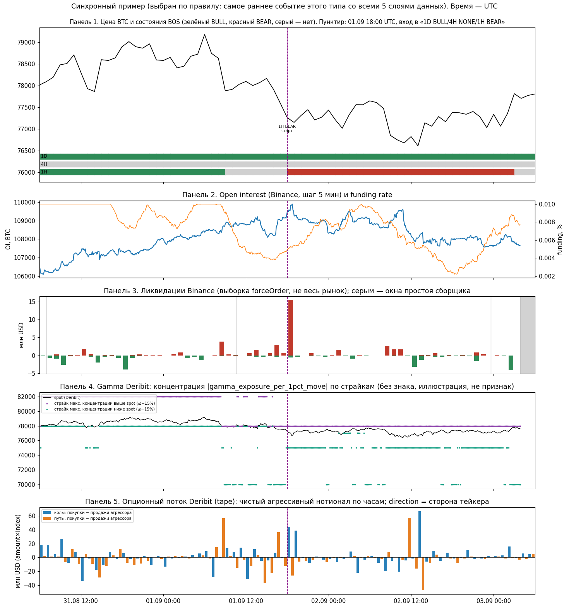

# BTC BOS × derivatives — Phase 1, first result (audit, observation units, join design)

Date: 2026-10-07. Status: **first result; paused for review**. Phase 2 (attribution) has not started; no hypotheses have been tested, no thresholds fitted, and `bot_v2.py` has not been changed.
All times are UTC. Collector logs use Moscow time (UTC+3) and have been converted; the `Time` column in the bot log is UTC (checked against file mtime).

## 0. Verdict

**Insufficient data (attribution calculations have not started and cannot yield a conclusion from these data).** Reasons, in descending order of importance:

1. **Almost no independent 1D regimes.** In the common data window (from 2026‑08‑29 11:28 UTC), there are only **2 BULL episodes** on 1D, both in the same direction; one began before the window (left censored), and the other is still active (right censored). There are no BEAR episodes on 1D. Under the N<10 clusters rule, every cell dependent on 1D is `INSUFFICIENT SAMPLE`.
2. **Nesting.** There are 6 4H episodes and 17 1H episodes in the window, but all lie within 2–3 1D regimes. Nested observations cannot be used to inflate N.
3. **Derivatives data completeness at event times:** all five layers are simultaneously available for only 11 of 25 episode starts and 23 of 43 multi-timeframe transitions.
4. **Shared machine outages** (≈7–8% of the time) interrupt all streams simultaneously.

This is an acceptable Phase 1 result: “there are not yet enough independent market regimes to answer the question.”

## 1. Files found

| Dataset | File | Size | Note |
|---|---|---|---|
| BOS source code | `bot_v2.py` | 1374 lines, sha256 `b1f4eaa37187cb2917b92471c4dff9f71ecd88e6e3c4d0e539b8cf7abaa996c8` | mtime 2026‑08‑25 17:21; the current process (PID 89821) started on 2026‑09‑12 11:46, after the file change — the same logic since 25.08 |
| BOS production log | `btc_signals_log(*)_v4.csv` | 48 files, 1987 rows, 2026‑08‑21 → 2026‑10‑07 | Written on every tick, ~30 min |
| Price (new) | `LAB_attrib_p1/raw/BTCUSDT_{1d,4h,1h}_binance_raw.csv` | 644 / 1136 / 2745 candles | Binance spot `/api/v3/klines`, downloaded 2026‑10‑07 09:33 UTC; closed candles only, 0 gaps; read-only files (sha256: 1d `f1fcbd1e…`, 4h `f43d66ee…`, 1h `258e784e…`) |
| Price (old) | `BTCUSDT_1h_history_full.csv` and others | End on 20.08 / 28.08; no 4H | Not used or modified |
| OI | `oi_raw.csv` | 10 423 | Binance, symbol BTCUSDT |
| funding/mark | `funding_markprice_raw.csv` | 3 123 108 | ~1 row/sec |
| liquidations | `liquidations_raw.csv` | 34 026 | Binance forceOrder, sampled |
| gamma | `gamma_snapshot_agg.csv` / `gamma_snapshot_raw.csv` | 6 525 / 2 527 713 | Deribit BTC |
| options tape | `deribit_option_trades_raw.csv` + `deribit_trade_tape_cursor.json` | 246 190 | Deribit |
| Backfills (not used) | `oi_history_backfill_30d.csv` (8 928), `funding_rate_history_backfill.csv` (500) | | The 30-day OI backfill could fill OI gaps — see §9 |
| Collector logs | `liq_collector.log`, `funding_oi_collector.log`, `gamma_collector.log`, `deribit_trade_tape_collector.log(.1–.3)` | | Used only as evidence of operation, not as substitutes for timestamps |

Code and intermediate results: `LAB_attrib_p1/scripts/01…12_*.py`, `LAB_attrib_p1/out/`. BOS code was extracted verbatim from `bot_v2.py` using its AST (the module was not imported: it configures `logging.basicConfig` to write to the production `bot_errors.log`); the extracted file contains no secrets, and the source hash is recorded in the header of `scripts/bot_v2_extracted.py`.

## 2. Coverage and gap report (actual timestamps)

| Stream | First — last record | N | Expected frequency | Coverage | Duplicates | Gaps above threshold | Largest gap |
|---|---|---|---|---|---|---|---|
| OI | 08‑28 21:05 → 10‑07 09:35 | 10 423 | 5 min | **91.5%** of slots | 13 rows within slots | 38 (>15 min) | 9 h 10 min (23.09) |
| funding/mark | 08‑29 11:28 → 10‑07 09:36 | 3 123 108 | ~1 sec | **92.0%** of seconds | 0 (by event_time_ms) | 99 (>60 sec), 36 (>10 min) | 8 h 18 min (ending 21.09 07:52) |
| gamma_agg | 08‑24 19:44 → 10‑07 09:30 | 6 525 | 10 min | 82.1% (**91.6%** excluding the known gap) | 1 373 slots with 2+ rows | 67 (>15 min) | **109 h** (02.10 10:10 → 06.10 23:10) |
| bot log | 08‑21 19:34 → 10‑07 09:27 | 1 987 | ~30 min | ~88.8% | 0 | 36 (>75 min) | 12 h 36 min (23.09) |
| liquidations | 08‑29 11:41 → 10‑07 09:35 | 34 026 | Event driven | **92.6%** of time valid under the mask | 0 | 170 outage windows | See §7 |
| tape | 08‑28 21:27 → 10‑07 09:36 | 246 190 | Event driven | See §7 | 0 | 2 gaps >1 h | 7 h 53 min (05.10) |
| 1d/4h/1h candles | — | 644/1136/2745 | — | 100% | 0 | 0 | — |

The year is 2026 throughout (verified by `assert`). Some timestamps with zero microseconds omit the fractional component (`…+00:00`), causing naive `pd.to_datetime` parsing to fail; `format="ISO8601"` was used.

**Shared outages.** All major funding gaps ≥30 min (top‑25 in `out/common_outages.csv`) coincide with gaps in OI, gamma, and the bot log: 20–21.09 (8.3 h), 12.09 (6.7 h), 03.09 (4.7 h), 16.09, 15.09, 19.09, and others. These are machine/network failures, not individual collector failures. **The network outage on 12.09** was examined separately: 01:54–08:38 UTC (6.7 h), plus three later windows that day (10:01–11:23, 11:52–15:03, 15:03–16:43), affecting all streams and the bot.

Unrecoverable gaps were not interpolated.

## 3. Independent BOS episodes (replay)

Replay reconstructs what the bot would have seen on every tick after a bar close, with a window of 499 closed bars + 1 forming bar, `compute_impulse(closed_only=True)`, and verbatim code. **Agreement with the production log:** 1D 100.0%, 4H 98.9%, 1H 99.1%; 40 discrepancies out of 5 961 tick×timeframe pairs, all `NONE` in the log versus `ACTIVE`/`ENDED` in replay, all after 13.09 (§9, item 7).

| Timeframe | Episodes intersecting the window | BULL / BEAR | Ended | Currently active | Left censored |
|---|---|---|---|---|---|
| 1D | **2** | 2 / 0 | 1 (pivot break) | 1 | 1 |
| 4H | 6 | 4 / 2 | 6 (pivot break) | 0 | 0 |
| 1H | 17 | 8 / 9 | 16 (15 pivot breaks, 1 opposite BOS) | 1 | 0 |

1D episodes: BULL from 2026‑08‑19 to 2026‑09‑15 (left censored, age 26 bars), and BULL from 2026‑09‑18 to the report date (18 bars, right censored). Between them, 1D is inactive for ~3 days.

## 4. Structural transitions

Timeframe state = ACTIVE direction or `NONE` (`ENDED` and `NONE` are combined as “no active impulse”).

| Transition | 1D | 4H | 1H |
|---|---|---|---|
| NONE→BULL | 1 | 3 | 8 |
| NONE→BEAR | 0 | 2 | 7 |
| BULL→NONE | 1 | 4 | 7 |
| BEAR→NONE | 0 | 2 | 8 |
| BULL→BEAR (opposite BOS) | 0 | 0 | 1 |
| BEAR→BULL | 0 | 0 | 0 |

**Multiple timeframes.** On the 1H close grid, the window contains 12 distinct states, 44 segments, and **43 transitions**; median segment duration is 18 h. Most frequent states (hours): `1D BULL/4H BULL/1H NONE` 178, `1D BULL/4H NONE/1H BEAR` 177, `1D BULL/4H BULL/1H BULL` 169, `1D BULL/4H NONE/1H NONE` 137. `1D NONE` totals only 72 h. Segment entries are listed in `out/multi_tf_segments.csv`.

**The requested sequence** `1D BULL / 4H NONE / 1H BEAR`: **7 entries** (5 from `…4H NONE/1H NONE`, 2 from `…4H BULL/1H BEAR`), median duration 17 h, maximum 61 h; entries span two 1D regimes: **4** in the first BULL episode (01.09, 07.09, 09.09, 15.09) and **3** in the second (24.09, 28.09, 07.10). Thus there are 2 independent clusters, not 7. Comparing `1D BULL/4H NONE/1H BEAR` with `1D BULL/4H BULL/1H BEAR`, the latter state appears only 3 times, with a median duration of 3 h.

## 5. Observation unit

- **A. BOS episode.** Key `(tf, direction, start_bar_open)`. Decision time `T` = BOS bar close (first tick with `ACTIVE`). End = the close of the bar triggering a pivot break or opposite BOS. Unfinished episodes are marked as right censored (`ended_observed=False`).
- **B. Structural transition.** Change in the vector `(1D, 4H, 1H)` on the 1H close grid; `T` = close of the 1H bar where the vector changed.
- **Cluster for uncertainty:** the 1D episode (regime) is the top level; 4H and 1H episodes are nested. Ticks spaced 30 minutes apart are not considered independent.
- Bot log rows are not used as observation units.

## 6. Proposed causal join design

For an event at `T` (bar close), features use only records with `timestamp ≤ T`; the nearest future value is never used; a stale value becomes `MISSING`, rather than being forward-filled.

| Layer | Record time | Freshness rule | Additional validity condition |
|---|---|---|---|
| OI | `recv_ts_utc` | ≤ 15 min | Slot is not in a gap |
| funding | `recv_ts_utc` | ≤ 60 sec | — |
| gamma | `snapshot_ts_utc` (10 min slot, deduplicated by slot) | ≤ 20 min | Only the segment before 2026‑10‑02 10:10; the segment after 10‑06 23:10 is still too short |
| liquidations | `recv_ts_utc` (median delay from `event_time_ms`: 0.07 sec) | Event within a valid window | Validity mask (§7); for feature window `[T‑24h,T]`, mask coverage ≥ 90% |
| tape | Trade `timestamp_ms` | Trade with `trade_time ≤ T` | Outside the exclusion window ±24 h (§7) |

Features are direction normalized: `s = +1` for BULL, `−1` for BEAR; BULL and BEAR are always reported separately before pooling. Gamma normalization for chain composition (expirations change `n`: 430→376) is allowed without a signed GEX model.

**Outcomes (specified in advance).** `P(T)` is the BOS bar close (execution and costs are not modeled). For `h ∈ {1,4,12,24}` hours (and 48, 72 with a sufficient sample): `R_h = s·(P(T+h)/P(T) − 1)`; MFE/MAE use highs/lows of 1H bars in `(T, T+h]`, direction normalized; continuation = `R_h > 0`, reversal = `R_h < 0`, and `R_h = 0` belongs to neither class and is counted separately; time to the next transition uses a Kaplan–Meier curve with right censoring at 2026‑10‑07. `level_lost_5d`: **no definition found in the files** (§9, item 1).

## 7. Excluded periods and masks

| Item | Period / rule | Reason |
|---|---|---|
| gamma | 2026‑10‑02 10:10 → 2026‑10‑06 23:10 | Known unrecoverable gap (Deribit routing through VPN); the post-gap segment is shorter than a day |
| liquidations before launch | Everything before 2026‑08‑29 11:28:12 | The first session (from 28.08) connected to `/ws/btcusdt@forceOrder`, with 15 h of `events=0` while heartbeat reported “quiet stream — connection alive”; from 29.08 14:28 Moscow time, endpoint `/market/ws/…` |
| liquidations: outages | 170 windows, 68.9 h (7.4% of time): from a connection error until the connected message ∪ heartbeat gap >15 min | The 15 min threshold was chosen from the distribution (99.5% of intervals ≤12.4 min), robust over 10–30 min; **acceptance check:** only 74 of 34 026 events (0.22%) lie inside invalid windows; 63.3 of 67.4 h of windows ≥10 min overlap funding gaps |
| tape: confirmed gaps | 05.10 03:22–10:17 and 14:44–22:37 | Pauses of 7–8 h versus a maximum of 59 min elsewhere |
| tape: conservative exclusion | **2026‑10‑02 00:00 → 2026‑10‑06 23:05** (+24 h for the feature window) | Write lag rose to 17–24 h; checking one Deribit API endpoint suggested it did not return history older than roughly a day (exact retention was not measured); 10‑06 23:05 was a batch backfill of +166 rows |
| bot/replay during outages | Not excluded | BOS is reconstructed from Binance candles and is independent of machine downtime, but derivatives features during those hours are `MISSING` |

**Correction to my earlier message:** I wrote that October 3–5 had “three times fewer trades than normal.” October 3–4 were Saturday and Sunday; clean weekends (29–30.08, 05–06.09, 12–13.09, 19–20.09, 26–27.09) had 2 123–4 699 trades per day, while October 3 and 4 had 2 187 and 2 242, within that range. Only the two October 5 windows are confirmed losses. The rule “hourly count below the minimum across all clean weeks for the day×hour cell” flagged 53 hours over 2–6.10, versus ~20 expected by chance (rough estimate 1/(n+1) per hour). This indicates degradation but cannot locate it hour by hour. The 2.10–6.10 exclusion is deliberately conservative.

## 8. Synchronized chart example

**Selection rule (specified before inspection):** the earliest entry into `1D BULL / 4H NONE / 1H BEAR` with all five layers available according to `out/event_availability.csv`: **2026‑09‑01 18:00 UTC**. This is one illustration, without evidential weight.
What it shows (observation, not a conclusion): long liquidations in the hour *before* the event total 0.73 million USD (46 events), versus 15.45 million USD (216 events) in the hour *after*. The spike therefore follows BOS rather than preceding it. The gamma panel is an illustration (the strike with maximum `|gamma_exposure_per_1pct_move|` above/below spot), not a feature definition.

## 9. Methodological and data issues

1. **`level_lost_5d` is undefined in the files.** HANDOFF §4.2 and `Claude outputs/` contain only “whether the level held by day 5 (38% versus 94%)”, without specifying the level (BOS level? break level?), the rule (close on day 5 or any close during 5 days), or code. I **neither redefined nor calculated it**. The owner must provide an exact source/definition.
2. **A “connection alive” heartbeat does not prove event delivery** (28–29.08 case, §7). Liquidations require a mask based on errors, heartbeat intervals, and the events themselves.
3. **Heartbeat is not exactly every 5 min:** 8 606 intervals ≤10 min, 26 intervals >30 min. The first mask version, with a 7 min threshold, incorrectly classified 36% of time as downtime (31% of events fell into “invalid” windows). Corrected; the acceptance check is described in §7; v1 files were renamed `_SUPERSEDED_v1_*`.
4. **Two gamma instances** wrote to the same files from 12.09 to 06.10: 1 373 duplicate slots; analysis deduplicates by slot. Differences in values within duplicates were not compared.
5. **Shared machine/network cause of outages:** all coverage statistics are correlated; the streams are not independent.
6. **Tape:** `trade_id` is not monotonic in trade time (global Deribit counter, batch backfills); do not use it to order trades. Tape reliability before 02.10 was checked only with the day×hour rule and major gaps; days with many log warnings (12.09, 15.09, 19–24.09) were not examined separately.
7. **The bot log is unreliable as a structural record:** 40 ticks show `NONE` while replay shows `ACTIVE`/`ENDED`. The cause is **unverified**; one hypothesis is an incomplete API response (the code returns an empty DataFrame without logging). Replay was adopted as the primary source.
8. **BOS is not “pure structure”:** `_detect_swings` filters swings using EMA50, ATR, and volume (`High−EMA50 > 0.7·ATR`, `Volume > 1.05·MA20`). Definitions were not changed; ignoring volume applies only to the bot's other layers.
9. **Price regime:** 5–6 weeks, with only BULL episodes on 1D; findings cannot be generalized to BEAR/other regimes.
10. **Gamma size:** the raw file has 2.5 million rows; concentrations depend on weekly expirations (instrument count 430→376), requiring normalization before use.
11. **Rough time estimate to N=10 clusters** (Poisson estimate from observed frequency, regime dependent): around 200–400 days when clustering by 1D; ~4 additional weeks for 4H (6 over ~39 days); 17 1H clusters already exist, but all are nested within 2–3 1D regimes. The clustering level is an owner decision.
12. **Work possible independently of derivatives:** a BOS baseline (§4 of the specification) over long Binance candle history (4.5 years, 72 daily BOS events according to HANDOFF) would answer “what does BOS itself tell us?”, but not the derivatives question.
13. **Security (P0):** `bot_v2.py` and `bot_errors.log` (DEBUG logs the full Telegram URL) contain a bot token; `bot_v2.py` also contains Binance API keys. Values are not included in this report. Separate recommendation: `../SECURITY_RECOMMENDATION_secrets_in_logs.md`. This was kept separate from the research code.

## 10. Next minimal step and the decision it enables

| Owner decision | Result |
|---|---|
| Provide an exact definition of `level_lost_5d` | Enables completion of the BOS baseline under §4 of the specification |
| Choose the clustering level (strict 1D / 4H as a working compromise) | Determines when Phase 2 becomes statistically meaningful |
| Approve the §7 masks (especially the tape exclusion 02–06.10) | Freezes validity rules before Phase 2 |
| Decide whether to fill OI gaps with the 30-day backfill | OI coverage would rise from 91.5% to ~100%, but this is another source (`sum_open_interest`) and requires reconciliation |

Phase 2 has not started. Awaiting review.
